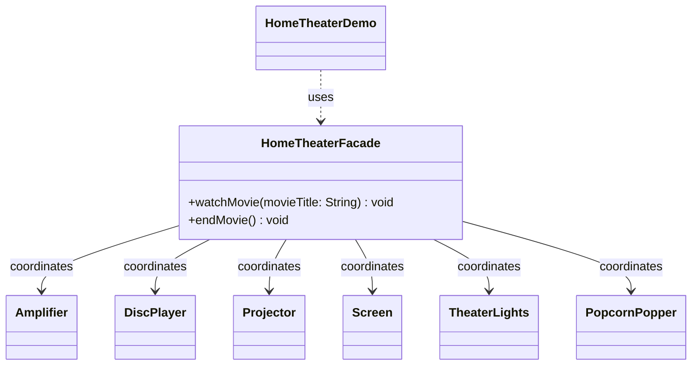

# Assignment 4 — Facade Pattern

**Course:** ShP-2216 — Software Design Patterns  
**Language:** Java 17  
**Chosen option:** Home Theater Facade

This project implements the Facade pattern around a home-theater subsystem. The client uses two high-level operations, `watchMovie(title)` and `endMovie()`. The facade coordinates the devices in the required order while each device keeps its own state and rules.

## Requirements covered

- Six collaborating subsystem classes with independent responsibilities.
- `HomeTheaterFacade` exposes a small API and owns the coordination sequence.
- `HomeTheaterDemo` talks to the facade only; it never constructs or calls a subsystem class.
- Subsystem classes do not refer to the facade and remain public for advanced clients.
- Invalid requests are rejected. A failed startup triggers best-effort cleanup; shutdown attempts every cleanup step and reports failures.
- Five Clean Code principles and before/after excerpts are explained in `docs/Assignment_Report.docx` and `docs/report.md`.

## Project structure

```text
src/main/java/edu/aitu/facade/hometheater/
├── client/       HomeTheaterDemo
├── facade/       HomeTheaterFacade
└── subsystem/    Amplifier, DiscPlayer, Projector, Screen,
                 TheaterLights, PopcornPopper
src/test/java/    FacadeBehaviorChecks (dependency-free checks)
docs/             report, UML source, and rendered diagram
scripts/          verification script
```

## Run and verify

Requires JDK 17. From the project root, run:

```bash
./scripts/verify.sh
```

The script compiles production and verification code with Java 17, treats compiler warnings as errors, runs checks for the facade's public behavior and call order, then runs the live demonstration. In IntelliJ IDEA, open the project and run `edu.aitu.facade.hometheater.client.HomeTheaterDemo`.

## Facade interaction



The arrows point from the facade to the subsystem. There is no back-reference from a device to the facade. Direct use is possible by constructing a subsystem class and calling its public operations; the demonstration client deliberately stays at the facade level.

## Defense notes

- **Why Facade?** Starting a movie requires several devices to be prepared in a particular order. The client should not need to know that sequence.
- **What is hidden?** Device setup, ordering, state checks, and coordinated cleanup.
- **What remains accessible?** Each subsystem class and its public operations. The pattern adds a simpler entry point; it does not remove the lower-level API.
- **Why is this not a Mediator?** The devices do not communicate through the facade or know about one another. The facade receives a client request and coordinates them.

## Git history

The local repository includes incremental commits for the project scaffold, subsystem classes, facade and client, and report. After creating an empty GitHub repository, publish with:

```bash
git remote add origin <your-github-repository-url>
git push -u origin main
```

Add the resulting URL to the report before uploading it to Moodle.
