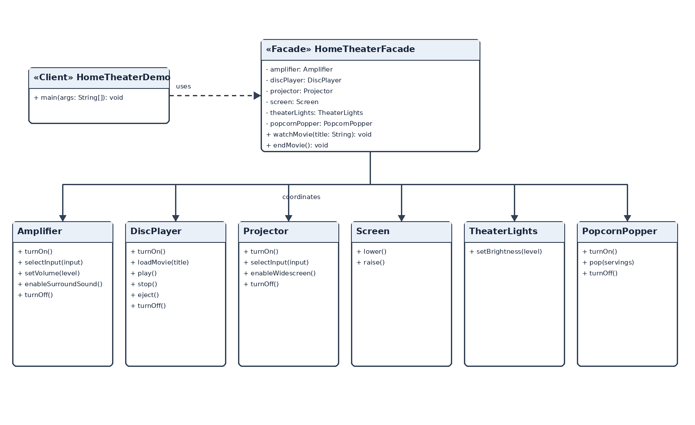

# Assignment 4 — Facade Pattern

**Course:** ShP-2216 — Software Design Patterns  
**Institution:** Astana IT University, School of Computer Engineering  
**Chosen option:** Home Theater Facade  
**Student:** ____________________  **Group:** ____________________  
**GitHub repository:** Add the repository URL after publishing the local Git repository.

## 1. Introduction

A home-theater session involves several independent devices: a popcorn popper, theater lights, a screen, a projector, an amplifier, and a disc player. Starting a movie requires these devices to be configured in a safe order; ending the session requires a coordinated shutdown. If a client controls every device directly, it must know the subsystem's setup sequence and remember to restore each device afterward.

This project applies the Facade pattern through `HomeTheaterFacade`. Its public API contains `watchMovie(String movieTitle)` and `endMovie()`. The facade coordinates the subsystem while each device retains its own state and validation rules. The sample client uses only the facade.

## 2. UML class diagram



`HomeTheaterDemo` depends on the facade. The facade holds and coordinates the six subsystem objects. No subsystem class refers back to the facade. Each subsystem class is public and can still be used directly by an advanced client.

## 3. Operation sequence

`watchMovie` validates the title and rejects a second movie while one is active. It then turns on the popper and pops a batch, dims the lights, lowers the screen, configures the projector, configures the amplifier, and loads and plays the movie. `endMovie` stops and ejects the disc, then turns off the amplifier and projector, raises the screen, restores full lighting, and turns off the popper.

If startup fails partway through, the facade attempts to restore the devices to their idle state and preserves cleanup failures as suppressed exceptions. During shutdown it attempts every cleanup step and reports an aggregate failure if any step fails. Subsystem classes also reject invalid direct operations, such as playing a movie before one has been loaded.

## 4. Clean Code principles

### 4.1 Meaningful names

Operation names describe the result the client wants. The caller does not need to infer what a generic `start()` method starts.

```java
// Before: vague intent
facade.start("Interstellar");

// Applied: explicit, domain-level intent
facade.watchMovie("Interstellar");
facade.endMovie();
```

### 4.2 Single Responsibility

The facade coordinates the sequence; the amplifier owns amplifier state and rules. Audio settings are not reimplemented inside the facade.

```java
// Applied in HomeTheaterFacade
perform("Setting amplifier volume to 35.", () -> amplifier.setVolume(35));

// Applied in Amplifier
public void setVolume(int volume) {
    requirePoweredOn();
    if (volume < 0 || volume > 100) {
        throw new IllegalArgumentException("Volume must be between 0 and 100.");
    }
    this.volume = volume;
}
```

### 4.3 No subsystem details in the facade's public API

A long list of device objects would make the client assemble the subsystem itself. The facade accepts only the movie title for startup and exposes a separate end operation.

```java
// Before: subsystem details leak to every caller
watchMovie(amplifier, discPlayer, projector, screen, lights, popper, title);

// Applied public API
public void watchMovie(String movieTitle)
public void endMovie()
```

### 4.4 Small, focused subsystem classes

Each class owns one device's state and operations. For example, `TheaterLights` validates brightness values; it does not control the screen or projector.

```java
// Applied in TheaterLights
public void setBrightness(int brightness) {
    if (brightness < 0 || brightness > 100) {
        throw new IllegalArgumentException("Brightness must be between 0 and 100.");
    }
    this.brightness = brightness;
}
```

### 4.5 Explicit error handling and state rules

The facade rejects invalid session transitions before operating the devices. Startup failures trigger cleanup, while shutdown continues through all cleanup steps and attaches additional failures to the first one.

```java
// Applied in HomeTheaterFacade
if (activeMovieTitle != null) {
    throw new IllegalStateException("A movie is already playing. End it before starting another.");
}

try {
    perform("Turning on popcorn popper.", popcornPopper::turnOn);
    // The remaining subsystem setup steps follow in order.
} catch (RuntimeException cause) {
    IllegalStateException failure = new IllegalStateException("Could not start the movie session.", cause);
    rollBackStartup(failure);
    throw failure;
}
```

## 5. Conclusion

The facade hides device setup order, session-level state checks, and coordinated rollback and shutdown. It makes the common movie-watching task available through two operations. The lower-level subsystem classes remain public and independent, so advanced clients can still use `Amplifier`, `DiscPlayer`, `Projector`, `Screen`, `TheaterLights`, or `PopcornPopper` directly. This balance is the key design choice: the facade simplifies routine use without making the subsystem inaccessible.

## 6. Repository link

**GitHub URL:** Add the URL after pushing this local repository to GitHub.
